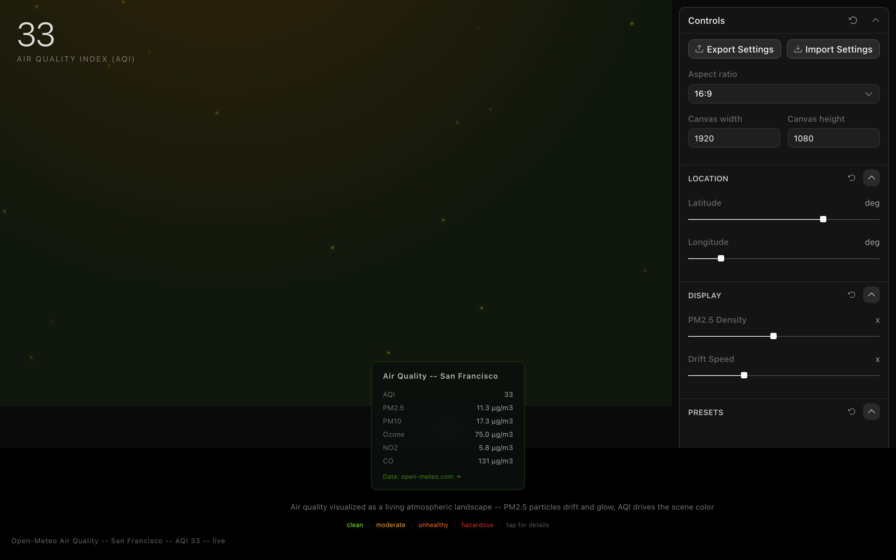

<div align="center">

<h1>aria</h1>

<p><b>Air quality as drifting, glowing particles.</b></p>

<p><i>PM2.5 is invisible. Here it floats across a dark forest night, turning from firefly green to ember red as the air gets worse.</i></p>

<h6>


</h6>

<a href="https://aria.parthchandak.info"><b>Live demo</b></a> ·
<a href="#how-it-works"><b>How it works</b></a> ·
<a href="#run-it"><b>Run it</b></a>

<br><br>

<a href="https://aria.parthchandak.info"></a>

<sub>Live capture, 22 October 2026, after a tap on the canvas. Real Open-Meteo data for San Francisco.</sub>

</div>

<br>

A Canvas 2D particle field driven by the
[Open-Meteo Air Quality API](https://open-meteo.com/en/docs/air-quality-api). It loads the
current European AQI and pollutant levels for a point on the map (San Francisco by default) and
lets them set the colour, size and pace of a field of bioluminescent specks. Clean air looks like
a quiet green night; polluted air glows amber and red. No API key is needed.

## How it works

| Air quality field | Drives |
|---|---|
| `european_aqi` | Background haze tint in five bands (green, yellow-green, amber, orange, red), particle warmth, and the big number |
| `pm2_5` | Particle size and brightness |
| `ozone` | A radial haze from the top of the sky, green when low and orange when high |
| `carbon_monoxide` | How fast the particles drift |
| `pm10`, `nitrogen_dioxide` | Shown in the detail panel |

Each particle is drawn in three layers (soft outer glow, coloured core, white centre) and wraps
around the edges. Click or tap the canvas for a ripple and a panel with every pollutant for the
current location; it fades after three seconds. Latitude and longitude sliders in the side panel
pick any point on Earth and refetch. The stamp in the bottom-left says `live` or `fallback`.

> [!NOTE]
> This is a one-day experiment and some controls are unfinished. The preset
> buttons (San Francisco, Beijing, Delhi, Sydney) are not wired to an action handler; the
> density and drift sliders are read once when the canvas mounts; and the AQI headline
> refreshes every minute from San Francisco regardless of the chosen location.

## Run it

```bash
git clone https://github.com/parthchandak02/aria.git
cd aria
npm install
npm run dev      # Vite dev server, prefers port 3002
npm run build    # static site in dist/
```

The live version runs on Cloudflare Pages.

<details>
<summary><b>Project layout</b></summary>

The app sits on the [Toolcraft](LICENSE.md) template from Pixel Point (MIT), which provides the
editor shell, side panel and a large verification harness. The piece itself is small:

```
src/components/AirCanvas.tsx   Data fetch, particle system and render loop
src/routes/index.tsx           Hero number, stamp, legend and the tap detail panel
src/app/app-schema.ts          Side-panel controls (location, display, presets)
src/toolcraft/                 Vendored Toolcraft runtime (do not edit)
AGENTS.md, docs/toolcraft/     Toolcraft's rules for working in this template
```

</details>

<br>

<div align="center">
<sub>Built with React, Canvas 2D, Toolcraft and Vite. Data from Open-Meteo Air Quality.</sub>
</div>
