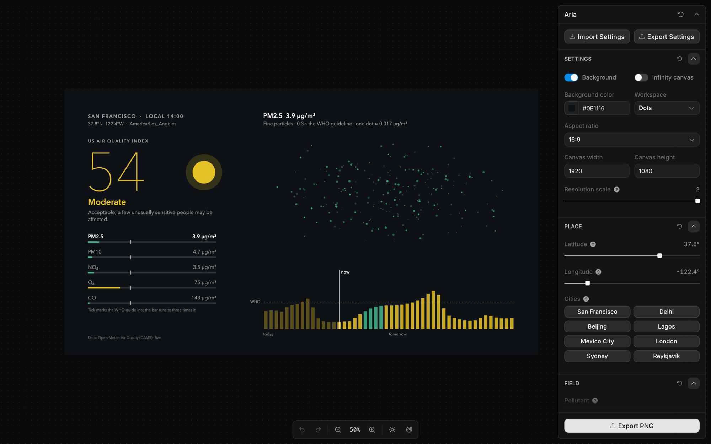

<div align="center">

<h1>Aria</h1>

<p><b>The air you are breathing, as a poster.</b></p>

<p><i>Pick a place and read its live air quality: the US AQI and what it means, five pollutants against WHO guidelines, and the next 48 hours.</i></p>

<h6>


</h6>

<a href="https://aria.parthchandak.info"><b>Live app</b></a> ·
<a href="#how-it-works"><b>How it works</b></a> ·
<a href="#run-it"><b>Run it</b></a>

<br><br>

<a href="https://aria.parthchandak.info"></a>

<sub>The default poster: San Francisco with live data.</sub>

</div>

<br>

Aria turns one place's air into a poster. The left side names the place and its local time, shows
the US Air Quality Index in large numerals with a status light in its band colour, the band's name
and health note, and gauges for PM2.5, PM10, nitrogen dioxide, ozone and carbon monoxide, each with
a tick at the World Health Organization guideline. The right side fills a field with dots for the
chosen pollutant (one dot for a fixed share of its guideline, so dirtier air means a denser field)
and draws its forecast for the next 48 hours, coloured by the hourly AQI band.

Drag Latitude and Longitude, or pick one of eight cities: San Francisco, Delhi, Beijing, Lagos,
Mexico City, London, Sydney and Reykjavík. Choose which pollutant the field and forecast show. The
background can be changed or left out, and the poster exports as PNG or JPG at 2K, 4K or 8K.

## How it works

Readings come from the free [Open-Meteo Air Quality API](https://open-meteo.com/en/docs/air-quality-api)
(CAMS model data), fetched once per place and cached. If the API cannot be reached, the poster shows
a clearly labelled offline sample instead of live numbers. AQI bands follow the US EPA; guideline
ticks use the WHO 2021 limits (PM2.5 15, PM10 45, NO₂ 25, ozone 100 µg/m³).

The poster is drawn with Canvas 2D in a Web Worker at the exact zoomed backing resolution, and the
same drawing function renders the exported image. The editor shell, panel, settings import/export,
saved workspace and image export come from [Toolcraft](https://github.com/pixel-point/toolcraft)
(Pixel Point, MIT).

## Run it

```bash
git clone https://github.com/parthchandak02/aria.git
cd aria
npm install
npm run dev              # local editor; needs Node 22+
npm test                 # unit tests plus Toolcraft's contract checks
npm run verify:delivery  # full functional acceptance in a real browser
```

The live version is a static build (`npm run build`, then `dist/`) on Cloudflare Pages.

<details>
<summary><b>Project layout</b></summary>

```
src/aria/air-data.ts            Open-Meteo request, parsing, cache, AQI bands, offline sample
src/aria/aria-draw.ts           Draws the whole poster; preview and export share it
src/aria/AriaCanvas.tsx         The live canvas: worker raster at the exact backing size
src/aria/aria-controls.ts       Place and Field controls; city shortcuts
src/app/app-schema.ts           Toolcraft schema: sections, canvas, image export
src/app/app-acceptance-data.ts  What every control must visibly do (checked in a real browser)
e2e/product-aria-*.spec.ts      Browser acceptance tests, one file per area (API stubbed)
src/toolcraft/                  Vendored Toolcraft runtime (do not edit)
```

</details>

<br>

<div align="center">
<sub>Built with Toolcraft, React and Canvas 2D. Air data from Open-Meteo and CAMS.</sub>
</div>
